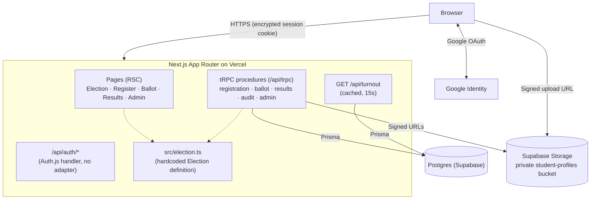

# Live Voting: Software Design Document

| | |
|---|---|
| **Status** | Draft for team review |
| **Last updated** | 2026-11-09 |
| **Related** | [Product Spec](./product-spec.md) · [Glossary](./GLOSSARY.md) · [ADR 0002: Ballots Linked to Voters](./adr/0002-ballots-linked-to-voters.md) (supersedes [ADR 0001](./adr/0001-unlinkable-ballots.md)) · [ADR 0003: Hardcoded Election Definition](./adr/0003-hardcoded-election-definition.md) · [ADR 0004: Own Person Table](./adr/0004-own-person-table-without-auth-adapter.md) · [ADR 0005: Turnout Public, Results Released](./adr/0005-turnout-public-results-released.md) · [ADR 0006: Advisory OCR on Student Profiles](./adr/0006-advisory-ocr-on-student-profiles.md) · [ADR 0007: tRPC API Layer](./adr/0007-trpc-api-layer.md) · [ADR 0008: Held Ballots for Late Registrations](./adr/0008-held-ballots-for-late-registrations.md) |

This document describes *how* we build what the [Product Spec](./product-spec.md) describes. Domain terms (Election, Question, Candidate, Party, Independent, Selection Limit, Registration, Registration Period, Applicant, Student Profile, Year Level, Voter, Ballot, Held Ballot, Abstention, Turnout, Results, Admin) are used exactly as defined in the [Glossary](./GLOSSARY.md).

## 1. Architecture overview



### Stack

| Concern | Choice |
|---|---|
| Framework | Next.js (App Router), TypeScript |
| Auth | Auth.js (NextAuth v5), Google provider, JWT session strategy, no database adapter |
| Database | Postgres on Supabase, accessed only through Prisma |
| File storage | Supabase Storage, one private bucket for Student Profiles |
| API layer | tRPC v11 (reads and mutations), zod input schemas, `@trpc/tanstack-react-query` on the client (ADR 0007) |
| Turnout reads | One cached GET route handler outside tRPC, polled with React Query |
| Hosting | Vercel |

**Why Auth.js without a database adapter:** sessions live in an encrypted cookie, so we don't need Auth.js's users, accounts and sessions tables. We do store each person's email and name, but in our own `Person` table, upserted on sign-in (§4.2), so the schema stays ours.

**Why signed upload URLs for Student Profiles:** Vercel functions reject request bodies over 4.5 MB. The browser uploads the image straight to Supabase Storage using a short-lived signed URL, and the tRPC procedure only receives the storage path.

**Why tRPC (ADR 0007):** authorization is part of each procedure's type (`adminProcedure`, `voterProcedure`), so a missing guard shows up in review. Every procedure also requires a zod input schema, and each entity follows the same structure. Turnout stays a plain route handler so its cache is shared across every client.

**Not using Supabase Realtime.** Polling every 15 seconds is enough for Turnout.

## 2. Election definition (hardcoded)

There is exactly one Election. Its Parties, Questions and Candidates live in a typed config file in the repo, not the database. Every Voter sees the same Questions.

```ts
// src/election.ts
export const PARTIES = ["STAND", "Tingog", "SPP"] as const;
export type PartyId = (typeof PARTIES)[number];

export type CandidateDef = {
  readonly id: string;      // stable, never changes once the Election has opened
  readonly name: string;
  readonly party?: PartyId; // omitted = Independent
  readonly photo: string;   // path under /public/candidates
  readonly bio: string;
};

export type QuestionDef = {
  readonly id: string;      // stable, never changes once the Election has opened
  readonly title: string;
  readonly selectionLimit: number;      // 1 = single choice
  readonly candidates: CandidateDef[];  // display order = array order
};

export type ElectionDef = {
  readonly id: string;
  readonly title: string;
  readonly questions: readonly QuestionDef[];
};

export const ELECTION = {
  id: "main",
  title: "…",
  questions: [/* … */],
} as const satisfies ElectionDef;

export const CURRENT_TERM = "1ST Semester 2026"; // compared with the term OCR reads from Student Profiles (ADR 0006)
```

**Rules:**
- Question and Candidate `id`s are stored in Ballot rows. **Never rename or remove an id after the Election has first opened**, or existing Ballots become orphaned.
- A Candidate's `party` must be one of `PARTIES`, or omitted for an Independent. The UI shows "Independent" when it's omitted.
- A unit test asserts that ids are unique, every `selectionLimit` is ≥ 1 and ≤ the number of Candidates, and every photo exists. `party` is checked by the type.
- Display order on the Ballot and in Results is the config array order.

## 3. Data model

```prisma
model ElectionState {
  id                 String         @id @default("main")
  registrationStatus WindowStatus   @default(CLOSED)
  electionStatus     WindowStatus   @default(CLOSED)
  resultsReleasedAt  DateTime?
  updatedAt          DateTime       @updatedAt
}

enum WindowStatus {
  OPEN
  CLOSED
}

/// Anyone who has signed in with a verified organization account.
model Person {
  id           String        @id @default(uuid())
  email        String        @unique // lowercased and trimmed
  name         String
  createdAt    DateTime      @default(now())
  registration Registration?
  ballot       Ballot?
}

model Registration {
  id              String             @id @default(uuid())
  personId        String             @unique
  person          Person             @relation(fields: [personId], references: [id])
  yearLevel       String             // one of YEAR_LEVELS; may be corrected by an Admin on approval
  school          String?            // one of SCHOOLS; null for Registrations made before School was collected
  studentProfilePath String          // object path in the student-profiles bucket
  ocrStatus       OcrStatus          @default(PENDING)
  ocrResult       Json?              // the four extracted fields and their match results only, never the full OCR text (ADR 0006)
  status          RegistrationStatus @default(PENDING)
  rejectionReason String?
  reviewedBy      String?            // Admin email
  reviewedAt      DateTime?
  submittedAt     DateTime           @default(now())
  updatedAt       DateTime           @updatedAt

  @@index([status, yearLevel])
}

enum RegistrationStatus {
  PENDING
  APPROVED
  REJECTED
}

enum OcrStatus {
  PENDING
  DONE
  FAILED
}

/// A cast Ballot, linked to its Voter (ADR 0002). It counts only while the Registration is APPROVED (ADR 0008).
model Ballot {
  id                    String         @id @default(uuid())
  personId              String         @unique // one Ballot per Voter
  person                Person         @relation(fields: [personId], references: [id])
  yearLevel             String         // snapshot of the Registration's Year Level at casting; updated if an Admin corrects it when approving a Held Ballot's Registration
  school                String?        // snapshot of the Registration's School at casting, kept in step the same way; filled by the one-time School prompt if the Voter voted first
  disclosureAcceptedAt  DateTime
  heldAcknowledgedAt    DateTime?      // set when cast without an approved Registration (FR-5.10)
  castAt                DateTime       @default(now())
  answers               BallotAnswer[]
}

/// One row per picked Candidate, or one row with candidateId = null for an Abstention.
model BallotAnswer {
  id          String  @id @default(uuid())
  ballotId    String
  questionId  String  // ELECTION.questions[].id
  candidateId String? // null = Abstention on this Question
  ballot      Ballot  @relation(fields: [ballotId], references: [id])

  @@unique([ballotId, questionId, candidateId])
  @@index([questionId, candidateId])
}

/// Granted by email, so a person can be made Admin before they first sign in.
model Admin {
  email     String   @id // lowercased and trimmed
  grantedBy String   // Admin email, or "seed"
  grantedAt DateTime @default(now())
}

/// Append-only record of every Admin action, including views of Ballots.
model AuditLog {
  id         String   @id @default(uuid())
  adminEmail String
  action     String   // e.g. APPROVE_REGISTRATION, VIEW_BALLOTS, EXPORT_BALLOTS, RELEASE_RESULTS
  target     String?  // e.g. Registration id
  detail     Json?
  at         DateTime @default(now())

  @@index([at])
}
```

**Design notes**
- `Ballot.personId @unique` replaces the old `Participation` table as the one-Ballot-per-Voter guard.
- **School is for statistics only.** It works like Year Level: declared on the Registration (from `SCHOOLS` in `v1/registration/schema.ts`), correctable by an Admin on approval, and snapshotted on the Ballot. Both columns are nullable because School was added after Registration opened; see §5.5.
- **Year Level is information only.** It doesn't affect which Questions a Voter sees. `Registration.yearLevel` is declared by the Applicant and can be corrected by an Admin; `Ballot.yearLevel` is a snapshot at casting, so the audit and export show the Year Level as it was, even if the Registration is edited later.
- A Person with no Registration is just someone who signed in. Being an Applicant or Voter is derived from `Registration.status`.
- **Whether a Ballot counts is derived, not stored** (ADR 0008). A Ballot counts when its person's `Registration.status` is `APPROVED`; otherwise it's a Held Ballot. There's no status column on `Ballot` to keep in sync.
- `Ballot.heldAcknowledgedAt` isn't in the initial migration. Adding it needs a second migration, which a developer runs manually.
- `AuditLog` is append-only: the app never updates or deletes its rows.
- **Row Level Security is enabled on every table with no policies.** Prisma connects as the table owner and bypasses it, but Supabase's public REST API (anon key) can read nothing.
- Migrations are written by the implementer and run manually by a developer. Never auto-run on deploy.

## 4. Authentication and identity

### 4.1 Domain restriction

Google's `hd` *authorization parameter* only pre-filters the account picker and can be bypassed by anyone. The enforced check is in the Auth.js `signIn` callback, against the verified Google profile claims:

- `hd === ALLOWED_HOSTED_DOMAIN` (present only on Google Workspace accounts, so this rejects consumer accounts registered with an organization address)
- `email_verified === true`

If either fails, `signIn` returns `false` and the user sees the "organization accounts only" message.

### 4.2 Auth.js configuration

```ts
// src/server/auth.ts (sketch)
export const { auth, handlers, signIn, signOut } = NextAuth({
  providers: [
    Google({ authorization: { params: { hd: env.ALLOWED_HOSTED_DOMAIN, prompt: "select_account" } } }),
  ],
  session: { strategy: "jwt", maxAge: 8 * 60 * 60 }, // 8 hours
  callbacks: {
    signIn({ profile }) {
      return profile?.hd === env.ALLOWED_HOSTED_DOMAIN && profile?.email_verified === true;
    },
    async jwt({ token, profile }) {
      if (profile?.email) {
        // First sign-in: upsert the Person and keep only their id and email in the token.
        const person = await upsertPerson(profile.email, profile.name ?? profile.email);
        return { personId: person.id, email: person.email };
      }
      return token;
    },
    session({ session, token }) {
      return { expires: session.expires, user: { personId: token.personId, email: token.email } };
    },
  },
});
```

- `upsertPerson` lowercases and trims the email, and updates the name on every sign-in.
- Module augmentation types `Session["user"]` and `JWT` as `{ personId: string; email: string }`. No casts.
- Google access, refresh and ID tokens are never persisted.
- **Sessions can't be revoked server-side** and last up to 8 hours. This is acceptable because Registration status and Admin rights are both read from the database on every action, never from the cookie.

### 4.3 Authorization

| Action | Requirement |
|---|---|
| View Election, Candidates, Turnout, released Results | None (public) |
| Submit/resubmit Registration, view own status | Valid session; Registration Period **or** Election open |
| Cast Ballot | Valid session; own Registration exists (any status; not `APPROVED` → Held Ballot, ADR 0008); Election open |
| Any Admin action (§7) | Valid session **and** a row in `Admin` for `session.user.email`, looked up on every call |

Authorization is built into tRPC procedure types, defined in `src/server/trpc/init.ts` (ADR 0007):

| Procedure type | Requirement | Adds to `ctx` |
|---|---|---|
| `publicProcedure` | None | — |
| `protectedProcedure` | Valid session | `person` |
| `voterProcedure` | Valid session; own Registration is `APPROVED` (read from the database) | `person`, `registration` |
| `adminProcedure` | Valid session; a row in `Admin` for the session email (read from the database) | `person`, `adminEmail` |

Every procedure is declared with the narrowest type that fits. Hiding UI is never the guard. Admin rights don't depend on Registration: an Admin who wants to vote registers like everyone else. Window checks (Registration Period open, Election open) stay inside each operation's transaction, not in middleware, so they can't race a concurrent close.

**CSRF:** tRPC has no built-in origin check, so the `/api/trpc` route handler rejects any mutation whose `Origin` header doesn't match `AUTH_URL`.

In the sections below, "`protectedProcedure`" and "`adminProcedure`" name the procedure type each operation uses.

## 5. Registration

### 5.1 Uploading a Student Profile

1. `registration.createStudentProfileUpload` (`protectedProcedure`): check the Registration Period or the Election is open, then create a signed upload URL for `student-profiles/{personId}/{uuid}` (valid 5 minutes).
2. The browser uploads the image directly to that URL.
3. The bucket is **private** and restricted to `image/jpeg`, `image/png` and `image/webp`, max **5 MB** (enforced in bucket settings, and checked in the browser for a friendly error).

### 5.2 `submitRegistration({ yearLevel, school, studentProfilePath })`

```
1. person = ctx.person  (protectedProcedure)
2. validate: yearLevel ∈ YEAR_LEVELS and school ∈ SCHOOLS (zod enums in v1/registration/schema.ts, information only); studentProfilePath starts with "{personId}/"; object exists in bucket
3. transaction:
     a. registrationStatus or electionStatus must be OPEN (FOR SHARE on ElectionState)
        → so nothing can be submitted or resubmitted after the Election closes (ADR 0008)
     b. existing = Registration for person
        - none           → INSERT (status PENDING)
        - PENDING/REJECTED → UPDATE yearLevel, school, studentProfilePath, status=PENDING, clear rejection fields; a Held Ballot takes the new Year Level and School
        - APPROVED       → reject: "Your Registration is already approved"
     c. set ocrStatus=PENDING, ocrResult=null
4. after commit: schedule Student Profile OCR with Next.js after() (§5.4)
```

Old Student Profile objects from resubmissions are kept until after the Election (see §14).

### 5.3 Review

- `listRegistrations({ status?, yearLevel? })`: `adminProcedure`. Returns name, email, Year Level, status, whether the person has a Held Ballot, a signed **view** URL for each Student Profile (valid 10 minutes), and its `ocrStatus` and `ocrResult`. Registrations with a Held Ballot are sorted first.
- `approveRegistration(id, yearLevel, school?)`: `adminProcedure`. Sets `APPROVED`, the (possibly corrected) Year Level and School, `reviewedBy`, `reviewedAt`. If the person has a Held Ballot, sets `Ballot.yearLevel` and `Ballot.school` to the approved values in the same transaction, and the Ballot now counts. Writes `AuditLog`, including the original and approved School.
- `rejectRegistration(id, reason)`: `adminProcedure`. Reason is required and non-empty. Sets `REJECTED`. Writes `AuditLog`.
- OCR results are shown as hints next to the image. Neither procedure reads them.
- Review is allowed whether or not the Registration Period or the Election is open, so Admins can clear pending Registrations after either closes. Review acts only on `PENDING` Registrations, so after the Election closes a `REJECTED` Registration stays rejected.
- An approved Registration can't be changed once its Voter has cast a Ballot.

### 5.4 Student Profile OCR (ADR 0006)

OCR is advisory: it never changes a Registration's `status`, and a failure never blocks a Registration.

1. `submitRegistration` schedules OCR with Next.js `after()`, so the Applicant's response doesn't wait for it.
2. The job downloads the image from the `student-profiles` bucket with the service role key and runs PaddleOCR's PP-OCRv6 models through `onnxruntime-node`. The model files are bundled with the function.
3. It reads Full Name, Student ID and Year Level from the text to the right of each label (text box positions), down to halfway to the next label, because long names wrap onto two lines on mobile. It reads the term by pattern (`1ST Semester 2026`).
4. It compares each field with what the app already knows:
   - Student ID = the local part of `Person.email`, compared as text, because IDs can start with zero
   - every word of `Person.name` appears in Full Name, in any order
   - Year Level = the declared Year Level
   - term = `CURRENT_TERM` (§2)
5. It writes `ocrStatus=DONE` and `ocrResult` (the four fields and their matches), or `ocrStatus=FAILED` on error or timeout. It only writes if `studentProfilePath` is still the one it read, so a resubmission isn't overwritten by an older result.

**Rules:**
- Never store or log the full OCR text. The Student Profile also shows date of birth, which we don't need.
- `after()` runs within the route's `maxDuration`, so `/api/trpc` sets `maxDuration = 300`. A job waiting for the one-job-per-instance lock counts against the same limit, so the limit leaves room for a queue. On Vercel (1 vCPU, 2,048 MB), OCR takes 2–12 s per image and peaks at about 1.5 GB (task 2.10a, #28).
- Run at most one OCR job per function instance at a time. Two concurrent jobs would exceed 2 GB of memory.

### 5.5 One-time School prompt

School was added after Registration opened, so earlier Registrations (and their Ballots) have none.

- `registration.getMine` returns `school`. When it is null, the register page and the ballot page ask "Which School are you in?". On the ballot page the question comes before the Ballot, so new Ballots are counted under a School; a Voter who already voted sees it beside their receipt.
- `registration.setSchool({ school })`: `protectedProcedure`, acts only on the caller's own Registration. In one transaction: rejected once `resultsReleasedAt` is set; `FOR UPDATE` on the Registration; rejected with `CONFLICT` if a School is already recorded; otherwise sets `Registration.school` and fills `Ballot.school` where it is null. The row lock means a concurrent cast either reads the new School or is updated by it.
- Answers are self-declared. Only an Admin can change a recorded School, on approval, so a person can't change their answer to shift the statistics.

## 6. Casting a Ballot

### 6.1 Validation (pure function, unit tested)

Given a submitted Ballot `{ [questionId]: { abstain: true } | { candidateIds: string[] } }`:

1. The keys are exactly the ids of `ELECTION.questions`. A missing Question or an unknown Question is rejected.
2. For each Question, exactly one of:
   - `abstain: true`, or
   - `1 ≤ candidateIds.length ≤ selectionLimit`, all ids belong to that Question, no duplicates.
3. `disclosureAccepted === true`.
4. `heldAcknowledged === true` when the caller's Registration isn't `APPROVED`. This is checked in the procedure (§6.2), since it depends on the Registration.

Validation uses a Zod schema built from `ELECTION.questions`.

### 6.2 `ballot.cast` procedure (`protectedProcedure`)

Uses `protectedProcedure`, not `voterProcedure`, because Applicants can cast a Held Ballot and the Registration check must happen inside the transaction (step b).

```
1. person = ctx.person
2. prisma.$transaction(async tx => {
     a. state = SELECT electionStatus FROM "ElectionState" WHERE id='main' FOR SHARE
        → if not OPEN: throw ElectionClosed
     b. reg = Registration for person
        → if none: throw NotRegistered
        → held = reg.status != APPROVED; if held and !input.heldAcknowledged: throw HeldNotAcknowledged
     c. validated = validateBallot(input) → reject on failure
     d. INSERT INTO "Ballot" (personId, yearLevel and school = reg snapshots, disclosureAcceptedAt,
                              heldAcknowledgedAt = held ? now() : null)
        → unique violation on personId: throw AlreadyVoted
     e. INSERT INTO "BallotAnswer" rows (candidateId null for Abstentions)
   })
3. return { ok: true, held }  (never echo choices back)
```

- **One Ballot per Voter** is guaranteed by `Ballot.personId @unique`. Concurrent double submits: one commits, the other gets `AlreadyVoted`.
- **`FOR SHARE` on ElectionState** stops a Ballot committing after a concurrent close commits.
- The page checks for an existing Ballot on load to show "You have already voted," but that check is for UX only.

### 6.3 What must never happen

- Logging Ballot contents or `ballot.cast` inputs, including in tRPC error formatting and `onError` logging. Only Admins, through the audited screens, should see choices.
- Returning another person's Ballot, Registration or Student Profile URL to a non-Admin.
- Exposing per-Candidate counts on any public route before `resultsReleasedAt` is set.

## 7. Turnout, Results and audit

### 7.1 Turnout

`GET /api/turnout` (public route handler, `revalidate = 15`):

```
{ electionStatus, ballotsCast: COUNT(Ballot), approvedVoters: COUNT(Registration WHERE status = APPROVED) }
```

No per-Candidate data, ever. `ballotsCast` includes Held Ballots. Caching keeps load flat on election day; the client polls every 15 seconds.

### 7.2 Results

- `results.get`: `publicProcedure` that returns Results only if `resultsReleasedAt` is set or the caller has a row in `Admin` (checked in the database); everyone else gets `FORBIDDEN`. Returns per Question, in config order: count per Candidate (zero counts included), Abstentions, and Ballots that saw the Question. **Only Ballots whose Registration is `APPROVED` are counted** (join `Ballot` → `Registration`). It also returns the number of Held Ballots left out, split into pending and rejected.
- Admins see Results at any time on the Admin panel. Viewing them writes `AuditLog` (`VIEW_RESULTS`).
- `releaseResults()`: `adminProcedure`; the Election must be `CLOSED` and not already released, and no Ballot's Registration may be `PENDING`. All three are checked in one transaction with `FOR UPDATE` on `ElectionState`. Sets `resultsReleasedAt`. Writes `AuditLog`. There is no un-release. Since resubmitting needs the Election open, and the Election can't reopen after release, released Results can't change.
- The public `/results` page renders only when `resultsReleasedAt` is set.
- `admin.getDashboard` includes turnout per School: counted and held Ballots for each School in `SCHOOLS` order (zeros included), any stored code no longer in the list, and a "Not recorded" row when some Ballots have no School.
- `admin.getResultsBySchool()`: `adminProcedure`, Admin-only even after release, because in a small School the tally can point to how individuals voted. Same counting rule as `results.get`, split by `Ballot.school`; Prisma's `groupBy` can't group answers by a Ballot column, so the tally is one SQL query joining `BallotAnswer`, `Ballot` and `Registration`. Before release, each view writes `AuditLog` (`VIEW_RESULTS`, detail `{ bySchool: true }`), so the Admin page loads it only when asked.

### 7.3 Ballot audit

- `listBallots({ yearLevel?, search?, status? })`: `adminProcedure`. Returns each Ballot with name, email, Year Level, `castAt`, choices and status (`COUNTED`, `HELD_PENDING` or `HELD_REJECTED`, derived from the Registration). Paginated. Writes `AuditLog` (`VIEW_BALLOTS`) with the filters used.
- `exportBallots()`: `adminProcedure`. Returns a CSV with one row per Ballot, a status column and one column per Question. Writes `AuditLog` (`EXPORT_BALLOTS`).
- `listAuditLog()`: `adminProcedure`. So Admins can see who viewed what.

## 8. Administration

### 8.1 Windows

- `setRegistrationStatus("OPEN" | "CLOSED")` and `setElectionStatus("OPEN" | "CLOSED")`: `adminProcedure`, update `ElectionState`, write `AuditLog`.
- Reopening the Election is allowed (to extend past 5 PM) and doesn't touch Ballots. It's rejected once `resultsReleasedAt` is set.
- Closing the Election also ends late Registration and resubmission (§5.2). Reopening it allows them again.
- The `ElectionState` row is created by the initial migration/seed with everything `CLOSED`.

### 8.2 Admin management

- `grantAdmin(email)`: `adminProcedure`, validate and normalise the email (organization domain, lowercased, trimmed), upsert `Admin`. Works before the person has signed in.
- `revokeAdmin(email)`: `adminProcedure`; in one transaction, reject if this is the last Admin, otherwise remove the row. Takes effect on that person's next action.
- Both write `AuditLog`. The Admin panel lists Admins by email.

### 8.3 First Admin seed

A one-off script, run manually by a developer:

```
pnpm tsx scripts/seed-admin.ts --email first.admin@example.com [--dry-run]
```

It upserts the `Admin` row with `grantedBy = "seed"`, and with `--dry-run` prints what it would change without writing.

## 9. Security and privacy

| Threat | Mitigation |
|---|---|
| Non-member signs in | `signIn` enforces `hd` and `email_verified` (§4.1) |
| Unregistered person votes | `castBallot` requires a Registration inside the transaction (§6.2) |
| Unapproved person's Ballot counted | Results count only Ballots whose Registration is `APPROVED`; release is blocked while any Ballot's Registration is `PENDING`; no resubmission after close (§5.2, §7.2, ADR 0008) |
| Double voting | `Ballot.personId @unique` in the same transaction (§6.2) |
| Ballot with unknown Questions or Candidates | Server validates against `ELECTION.questions`; client input can't add others (§6.1) |
| Ballots or Student Profiles read by non-Admins | `adminProcedure` on every read; private bucket with short-lived signed URLs; RLS on all tables blocks Supabase's public API (§3) |
| Admin misuse of Ballot access | Every view and export is written to `AuditLog`, which Admins can read (§7.3) |
| Results leaked before release | No public route returns per-Candidate counts until `resultsReleasedAt` is set (§7.2) |
| Stolen session cookie | Encrypted, `HttpOnly`, `Secure`, `SameSite=Lax`; 8-hour expiry |
| Privilege escalation | Admin and Registration status read from the database on every call; the cookie carries no role |
| CSRF on tRPC mutations | `/api/trpc` rejects mutations whose `Origin` doesn't match `AUTH_URL`; `SameSite=Lax` cookies; Auth.js CSRF token on sign-in |
| Unguarded Admin operation | Authorization is the procedure type (`adminProcedure`), so it's visible in review; permission tests on every Admin procedure (§12) |
| Oversized or non-image uploads | Bucket MIME and size restrictions; path ownership checked on submit (§5) |
| Developer access to Ballots | Covered by the client's waiver |

## 10. Configuration

| Env var | Purpose |
|---|---|
| `DATABASE_URL` | Supabase pooled connection (Prisma runtime) |
| `DIRECT_URL` | Supabase direct connection (migrations) |
| `SUPABASE_URL` / `SUPABASE_SERVICE_ROLE_KEY` | Server-only, for creating signed Storage URLs. Never exposed to the browser |
| `AUTH_SECRET` | Auth.js cookie encryption |
| `AUTH_GOOGLE_ID` / `AUTH_GOOGLE_SECRET` | Google OAuth client |
| `AUTH_URL` | Public base URL (optional on Vercel) |
| `ALLOWED_HOSTED_DOMAIN` | The organization's Google Workspace domain (pending from the client) |

## 11. Project structure (proposed)

The App Router lives in a root `app/`. Everything else lives in `src/`, and `@/*` resolves to `./src/*` and then `./*`.

```
app/
  page.tsx                    # Election overview, Candidate profiles, Turnout
  register/page.tsx           # Registration form + status
  vote/page.tsx               # Disclosure, Ballot form, review/confirm
  results/page.tsx            # Public Results once released
  admin/
    page.tsx                  # Windows, Turnout, Results, release
    registrations/page.tsx    # Review queue
    ballots/page.tsx          # Ballot audit + export
    admins/page.tsx           # Grant/revoke, audit log
  api/auth/[...nextauth]/route.ts
  api/trpc/[trpc]/route.ts    # tRPC handler + Origin check on mutations
  api/turnout/route.ts        # Public, cached; outside tRPC (ADR 0007)
src/
  election.ts                 # Election definition: PARTIES, Questions, Candidates
  server/
    auth/
      config.ts               # Auth.js config (§4.2)
      person.ts               # upsertPerson
    trpc/
      init.ts                 # initTRPC, context, public/protected/voter/adminProcedure
      root.ts                 # appRouter: merges the v1 entity routers
      origin.ts               # Origin check for mutations (CSRF)
      server.tsx              # server-side caller, prefetch proxy, HydrateClient
      api/v1/
        {entity}/             # registration, ballot, election, results, audit, admin
          __tests__/          # core unit tests; procedure tests via createCaller
          core/               # shared domain logic, no I/O (e.g. validateBallot)
            queries/          # one file per query procedure, e.g. ping.ts
            mutations/        # one file per mutation procedure
          services/           # Prisma and Supabase Storage access
          schema.ts           # zod input/output schemas
          router.ts           # maps procedure names to the procedures in core/
    storage.ts                # Supabase Storage client (server-only)
  lib/
    db.ts                     # Prisma client
    trpc/client.tsx           # tRPC + React Query provider for Client Components
    trpc/query-client.ts      # shared QueryClient factory (superjson)
  types/next-auth.d.ts        # Session/JWT module augmentation
prisma/schema.prisma
scripts/seed-admin.ts
public/candidates/*
```

## 12. Testing strategy

| Level | Coverage |
|---|---|
| Unit | `validateBallot` (missing Question, unknown Question, over limit, duplicates, cross-Question Candidate, picks plus Abstention, disclosure not accepted); election config invariants; email normalisation |
| Integration (test Postgres) | Registration: submit only while the Registration Period or Election is open; resubmit after reject; no submit or resubmit after the Election closes; approved can't resubmit; path ownership check. Review: non-Admin rejected; approve with corrected Year Level (also updates a Held Ballot's Year Level); reject requires reason; AuditLog written. `castBallot`: approved → counted; pending/rejected → Held Ballot, and rejected without `heldAcknowledged`; no Registration → rejected; second cast → AlreadyVoted; **N concurrent casts by one Voter → exactly one Ballot**; cast while closed → rejected. Results: hidden publicly until released; Held Ballots excluded, then counted after approval (including after close); release only when closed and no Ballot's Registration is pending; no reopen after release. Audit: every `listBallots`/`exportBallots` writes AuditLog. Admin: revoked Admin rejected on next action; last-Admin revoke rejected |
| Auth | `signIn` rejects missing/foreign `hd` and `email_verified=false`; session contains only `personId`, `email` and standard claims |
| Procedure permissions | Through `createCaller` with fake contexts: every `adminProcedure` rejects signed-out, non-Admin and revoked-Admin callers; `voterProcedure` rejects pending, rejected and unregistered callers; mutations from a foreign `Origin` are rejected |
| Manual / E2E | Full flow with Workspace test accounts as Voters, an Admin, and one consumer account; dry-run election before Nov 20 |

## 13. Milestones

Registration opens **Nov 15** and the Election is **Nov 20**. After the foundation, Registration and Voting are built in parallel.

| # | Milestone | Must be live by |
|---|---|---|
| 1 | **Auth and data model**: Auth.js + Google with domain enforcement, `Person` upsert, Prisma schema and migrations (run manually), RLS, seed-admin script | Nov 7 |
| 2 | **Registration**: Student Profile upload and OCR, register/resubmit/status page, Admin review queue, Registration window toggle, Admin grant/revoke, AuditLog | **Nov 15** |
| 3 | **Voting** (parallel with 2): Election config with real Candidates, disclosure, Ballot UI with Party labels, `castBallot`, Election window toggle, Turnout | Nov 16 |
| 4 | **Results and audit**: Admin Results view, release, public Results page, Ballot audit list and CSV export | Nov 17 |
| 5 | **Hardening and dry run**: concurrency tests, load sanity check, logging review, end-to-end dry run with the commission | Nov 19 |

## 14. Open technical questions

- What happens to Student Profile images and Ballot data after the Election (retention period, deletion)? This needs a client decision, since the images are personal documents and show date of birth.
- Vercel route-handler caching for `revalidate = 15` on the chosen Next.js version. Confirm responses are shared across clients, or wrap the query in `unstable_cache`/`"use cache"`.
- Auth.js v5 maintenance status at build time. Pin the version and track security advisories.
- Expected number of Voters, to size the load check and the review queue.
