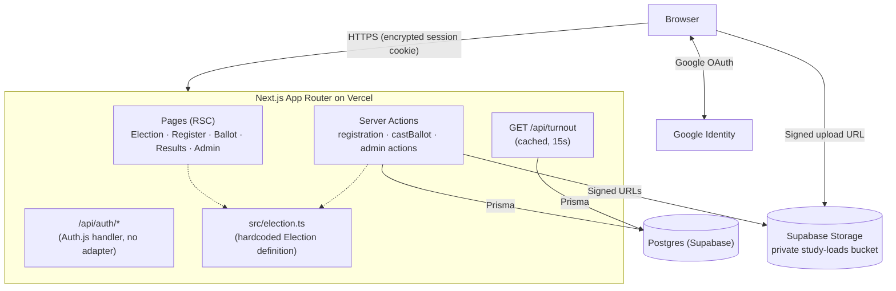

# Live Voting: Software Design Document

| | |
|---|---|
| **Status** | Draft for team review |
| **Last updated** | 2026-11-04 |
| **Related** | [Product Spec](./product-spec.md) · [Glossary](../GLOSSARY.md) · [ADR 0002: Ballots Linked to Voters](./adr/0002-ballots-linked-to-voters.md) (supersedes [ADR 0001](./adr/0001-unlinkable-ballots.md)) · [ADR 0003: Hardcoded Election Definition](./adr/0003-hardcoded-election-definition.md) · [ADR 0004: Own Person Table](./adr/0004-own-person-table-without-auth-adapter.md) · [ADR 0005: Turnout Public, Results Released](./adr/0005-turnout-public-results-released.md) |

This document describes *how* we build what the [Product Spec](./product-spec.md) describes. Domain terms (Election, Question, Year-Level Question, Candidate, Selection Limit, Registration, Registration Period, Applicant, Study Load, Year Level, Voter, Ballot, Abstention, Turnout, Results, Admin) are used exactly as defined in the [Glossary](../GLOSSARY.md).

## 1. Architecture overview



### Stack

| Concern | Choice |
|---|---|
| Framework | Next.js (App Router), TypeScript |
| Auth | Auth.js (NextAuth v5), Google provider, JWT session strategy, no database adapter |
| Database | Postgres on Supabase, accessed only through Prisma |
| File storage | Supabase Storage, one private bucket for Study Loads |
| Mutations | Next.js Server Actions |
| Turnout reads | One cached GET route handler, polled with React Query |
| Hosting | Vercel |

**Why Auth.js without a database adapter:** sessions live in an encrypted cookie, so we don't need Auth.js's users, accounts and sessions tables. We do store each person's email and name, but in our own `Person` table, upserted on sign-in (§4.2), so the schema stays ours.

**Why signed upload URLs for Study Loads:** Vercel functions reject request bodies over 4.5 MB, and Server Actions default to 1 MB. The browser uploads the image straight to Supabase Storage using a short-lived signed URL, and the Server Action only receives the storage path.

**Not using tRPC or Supabase Realtime.** There are only a handful of mutations and one public read. Server Actions give end-to-end types, and polling every 15 seconds is enough for Turnout.

## 2. Election definition (hardcoded)

There is exactly one Election. Its Questions, Candidates and Year Levels live in a typed config file in the repo, not the database.

```ts
// src/election.ts
export const YEAR_LEVELS = ["1", "2", "3", "4"] as const; // pending client confirmation
export type YearLevel = (typeof YEAR_LEVELS)[number];

export type CandidateDef = {
  id: string;        // stable, never changes once the Election has opened
  name: string;
  photo: string;     // path under /public/candidates
  bio: string;
};

export type QuestionDef = {
  id: string;        // stable, never changes once the Election has opened
  title: string;
  selectionLimit: number;   // 1 = single choice
  yearLevel?: YearLevel;    // set = Year-Level Question, shown only to Voters of that Year Level
  candidates: CandidateDef[]; // display order = array order
};

export const ELECTION = {
  id: "main",
  title: "…",
  questions: [/* … */] satisfies QuestionDef[],
} as const;

export function questionsFor(yearLevel: YearLevel): QuestionDef[] {
  return ELECTION.questions.filter(q => q.yearLevel === undefined || q.yearLevel === yearLevel);
}
```

**Rules:**
- Question and Candidate `id`s are stored in Ballot rows. **Never rename or remove an id after the Election has first opened**, or existing Ballots become orphaned.
- A unit test asserts that ids are unique, every `selectionLimit` is ≥ 1 and ≤ the number of Candidates, every `yearLevel` is in `YEAR_LEVELS`, and every photo exists.
- Display order on the Ballot and in Results is the config array order.

## 3. Data model

```prisma
model ElectionState {
  id                 String         @id @default("main")
  registrationStatus WindowStatus   @default(CLOSED)
  electionStatus     WindowStatus   @default(CLOSED)
  resultsReleasedAt  DateTime?
  updatedAt          DateTime       @updatedAt
}

enum WindowStatus {
  OPEN
  CLOSED
}

/// Anyone who has signed in with a verified organization account.
model Person {
  id           String        @id @default(uuid())
  email        String        @unique // lowercased and trimmed
  name         String
  createdAt    DateTime      @default(now())
  registration Registration?
  ballot       Ballot?
}

model Registration {
  id              String             @id @default(uuid())
  personId        String             @unique
  person          Person             @relation(fields: [personId], references: [id])
  yearLevel       String             // one of YEAR_LEVELS; may be corrected by an Admin on approval
  studyLoadPath   String             // object path in the study-loads bucket
  status          RegistrationStatus @default(PENDING)
  rejectionReason String?
  reviewedBy      String?            // Admin email
  reviewedAt      DateTime?
  submittedAt     DateTime           @default(now())
  updatedAt       DateTime           @updatedAt

  @@index([status, yearLevel])
}

enum RegistrationStatus {
  PENDING
  APPROVED
  REJECTED
}

/// A cast Ballot, linked to its Voter (ADR 0002).
model Ballot {
  id                    String         @id @default(uuid())
  personId              String         @unique // one Ballot per Voter
  person                Person         @relation(fields: [personId], references: [id])
  yearLevel             String         // snapshot of the approved Year Level at casting
  disclosureAcceptedAt  DateTime
  castAt                DateTime       @default(now())
  answers               BallotAnswer[]
}

/// One row per picked Candidate, or one row with candidateId = null for an Abstention.
model BallotAnswer {
  id          String  @id @default(uuid())
  ballotId    String
  questionId  String  // ELECTION.questions[].id
  candidateId String? // null = Abstention on this Question
  ballot      Ballot  @relation(fields: [ballotId], references: [id])

  @@unique([ballotId, questionId, candidateId])
  @@index([questionId, candidateId])
}

/// Granted by email, so a person can be made Admin before they first sign in.
model Admin {
  email     String   @id // lowercased and trimmed
  grantedBy String   // Admin email, or "seed"
  grantedAt DateTime @default(now())
}

/// Append-only record of every Admin action, including views of Ballots.
model AuditLog {
  id         String   @id @default(uuid())
  adminEmail String
  action     String   // e.g. APPROVE_REGISTRATION, VIEW_BALLOTS, EXPORT_BALLOTS, RELEASE_RESULTS
  target     String?  // e.g. Registration id
  detail     Json?
  at         DateTime @default(now())

  @@index([at])
}
```

**Design notes**
- `Ballot.personId @unique` replaces the old `Participation` table as the one-Ballot-per-Voter guard.
- `Ballot.yearLevel` is a snapshot, so the audit shows which Year-Level Question the Voter actually saw, even if their Registration is edited later.
- A Person with no Registration is just someone who signed in. Being an Applicant or Voter is derived from `Registration.status`.
- `AuditLog` is append-only: the app never updates or deletes its rows.
- **Row Level Security is enabled on every table with no policies.** Prisma connects as the table owner and bypasses it, but Supabase's public REST API (anon key) can read nothing.
- Migrations are written by the implementer and run manually by a developer. Never auto-run on deploy.

## 4. Authentication and identity

### 4.1 Domain restriction

Google's `hd` *authorization parameter* only pre-filters the account picker and can be bypassed by anyone. The enforced check is in the Auth.js `signIn` callback, against the verified Google profile claims:

- `hd === ALLOWED_HOSTED_DOMAIN` (present only on Google Workspace accounts, so this rejects consumer accounts registered with an organization address)
- `email_verified === true`

If either fails, `signIn` returns `false` and the user sees the "organization accounts only" message.

### 4.2 Auth.js configuration

```ts
// src/server/auth.ts (sketch)
export const { auth, handlers, signIn, signOut } = NextAuth({
  providers: [
    Google({ authorization: { params: { hd: env.ALLOWED_HOSTED_DOMAIN, prompt: "select_account" } } }),
  ],
  session: { strategy: "jwt", maxAge: 8 * 60 * 60 }, // 8 hours
  callbacks: {
    signIn({ profile }) {
      return profile?.hd === env.ALLOWED_HOSTED_DOMAIN && profile?.email_verified === true;
    },
    async jwt({ token, profile }) {
      if (profile?.email) {
        // First sign-in: upsert the Person and keep only their id and email in the token.
        const person = await upsertPerson(profile.email, profile.name ?? profile.email);
        return { personId: person.id, email: person.email };
      }
      return token;
    },
    session({ session, token }) {
      return { expires: session.expires, user: { personId: token.personId, email: token.email } };
    },
  },
});
```

- `upsertPerson` lowercases and trims the email, and updates the name on every sign-in.
- Module augmentation types `Session["user"]` and `JWT` as `{ personId: string; email: string }`. No casts.
- Google access, refresh and ID tokens are never persisted.
- **Sessions can't be revoked server-side** and last up to 8 hours. This is acceptable because Registration status and Admin rights are both read from the database on every action, never from the cookie.

### 4.3 Authorization

| Action | Requirement |
|---|---|
| View Election, Candidates, Turnout, released Results | None (public) |
| Submit/resubmit Registration, view own status | Valid session; Registration Period open |
| Cast Ballot | Valid session; own Registration is `APPROVED`; Election open |
| Any Admin action (§7) | Valid session **and** a row in `Admin` for `session.user.email`, looked up on every call |

`requireSession()`, `requireVoter()` and `requireAdmin()` live in `src/server/guards.ts`. Every Server Action calls the right one first; hiding UI is never the guard. Admin rights don't depend on Registration: an Admin who wants to vote registers like everyone else.

## 5. Registration

### 5.1 Uploading a Study Load

1. `createStudyLoadUpload()` Server Action: `requireSession()`, check Registration Period is open, then create a signed upload URL for `study-loads/{personId}/{uuid}` (valid 5 minutes).
2. The browser uploads the image directly to that URL.
3. The bucket is **private** and restricted to `image/jpeg`, `image/png` and `image/webp`, max **5 MB** (enforced in bucket settings, and checked in the browser for a friendly error).

### 5.2 `submitRegistration({ yearLevel, studyLoadPath })`

```
1. person = requireSession()
2. validate: yearLevel ∈ YEAR_LEVELS; studyLoadPath starts with "{personId}/"; object exists in bucket
3. transaction:
     a. registrationStatus must be OPEN (FOR SHARE on ElectionState)
     b. existing = Registration for person
        - none           → INSERT (status PENDING)
        - PENDING/REJECTED → UPDATE yearLevel, studyLoadPath, status=PENDING, clear rejection fields
        - APPROVED       → reject: "Your Registration is already approved"
```

Old Study Load objects from resubmissions are kept until after the Election (see §13).

### 5.3 Review

- `listRegistrations({ status?, yearLevel? })`: `requireAdmin()`. Returns name, email, Year Level, status and a signed **view** URL for each Study Load (valid 10 minutes).
- `approveRegistration(id, yearLevel)`: `requireAdmin()`. Sets `APPROVED`, the (possibly corrected) Year Level, `reviewedBy`, `reviewedAt`. Writes `AuditLog`.
- `rejectRegistration(id, reason)`: `requireAdmin()`. Reason is required and non-empty. Sets `REJECTED`. Writes `AuditLog`.
- Review is allowed whether or not the Registration Period is open, so Admins can clear pending Registrations after it closes.
- An approved Registration can't be changed once its Voter has cast a Ballot.

## 6. Casting a Ballot

### 6.1 Validation (pure function, unit tested)

Given the Voter's approved Year Level and a submitted Ballot `{ [questionId]: { abstain: true } | { candidateIds: string[] } }`:

1. The keys are exactly the ids of `questionsFor(yearLevel)`. A missing Question, an unknown Question, or another Year Level's Question is rejected.
2. For each Question, exactly one of:
   - `abstain: true`, or
   - `1 ≤ candidateIds.length ≤ selectionLimit`, all ids belong to that Question, no duplicates.
3. `disclosureAccepted === true`.

Validation uses a Zod schema built from `questionsFor(yearLevel)`.

### 6.2 `castBallot` Server Action

```
1. person = requireSession()
2. prisma.$transaction(async tx => {
     a. state = SELECT electionStatus FROM "ElectionState" WHERE id='main' FOR SHARE
        → if not OPEN: throw ElectionClosed
     b. reg = Registration for person
        → if not APPROVED: throw NotApproved
     c. validated = validateBallot(input, reg.yearLevel) → reject on failure
     d. INSERT INTO "Ballot" (personId, yearLevel, disclosureAcceptedAt)
        → unique violation on personId: throw AlreadyVoted
     e. INSERT INTO "BallotAnswer" rows (candidateId null for Abstentions)
   })
3. return { ok: true }  (never echo choices back)
```

- **One Ballot per Voter** is guaranteed by `Ballot.personId @unique`. Concurrent double submits: one commits, the other gets `AlreadyVoted`.
- **`FOR SHARE` on ElectionState** stops a Ballot committing after a concurrent close commits.
- The page checks for an existing Ballot on load to show "You have already voted," but that check is for UX only.

### 6.3 What must never happen

- Logging Ballot contents or Server Action inputs for casting. Only Admins, through the audited screens, should see choices.
- Returning another person's Ballot, Registration or Study Load URL to a non-Admin.
- Exposing per-Candidate counts on any public route before `resultsReleasedAt` is set.

## 7. Turnout, Results and audit

### 7.1 Turnout

`GET /api/turnout` (public route handler, `revalidate = 15`):

```
{ electionStatus, ballotsCast: COUNT(Ballot), approvedVoters: COUNT(Registration WHERE status = APPROVED) }
```

No per-Candidate data, ever. Caching keeps load flat on election day; the client polls every 15 seconds.

### 7.2 Results

- `getResults()`: `requireAdmin()`, or public if `resultsReleasedAt` is set. Returns per Question, in config order: count per Candidate (zero counts included), Abstentions, and Ballots that saw the Question.
- Admins see Results at any time on the Admin panel. Viewing them writes `AuditLog` (`VIEW_RESULTS`).
- `releaseResults()`: `requireAdmin()`; the Election must be `CLOSED` and not already released. Sets `resultsReleasedAt`. Writes `AuditLog`. There is no un-release.
- The public `/results` page renders only when `resultsReleasedAt` is set.

### 7.3 Ballot audit

- `listBallots({ yearLevel?, search? })`: `requireAdmin()`. Returns each Ballot with name, email, Year Level, `castAt` and choices. Paginated. Writes `AuditLog` (`VIEW_BALLOTS`) with the filters used.
- `exportBallots()`: `requireAdmin()`. Returns a CSV with one row per Ballot and one column per Question. Writes `AuditLog` (`EXPORT_BALLOTS`).
- `listAuditLog()`: `requireAdmin()`. So Admins can see who viewed what.

## 8. Administration

### 8.1 Windows

- `setRegistrationStatus("OPEN" | "CLOSED")` and `setElectionStatus("OPEN" | "CLOSED")`: `requireAdmin()`, update `ElectionState`, write `AuditLog`.
- Reopening the Election is allowed (to extend past 5 PM) and doesn't touch Ballots. It's rejected once `resultsReleasedAt` is set.
- The `ElectionState` row is created by the initial migration/seed with everything `CLOSED`.

### 8.2 Admin management

- `grantAdmin(email)`: `requireAdmin()`, validate and normalise the email (organization domain, lowercased, trimmed), upsert `Admin`. Works before the person has signed in.
- `revokeAdmin(email)`: `requireAdmin()`; in one transaction, reject if this is the last Admin, otherwise remove the row. Takes effect on that person's next action.
- Both write `AuditLog`. The Admin panel lists Admins by email.

### 8.3 First Admin seed

A one-off script, run manually by a developer:

```
pnpm tsx scripts/seed-admin.ts --email first.admin@example.com [--dry-run]
```

It upserts the `Admin` row with `grantedBy = "seed"`, and with `--dry-run` prints what it would change without writing.

## 9. Security and privacy

| Threat | Mitigation |
|---|---|
| Non-member signs in | `signIn` enforces `hd` and `email_verified` (§4.1) |
| Unregistered or rejected person votes | `castBallot` checks `APPROVED` inside the transaction (§6.2) |
| Double voting | `Ballot.personId @unique` in the same transaction (§6.2) |
| Wrong Year-Level Question | Server builds the allowed Questions from the approved Year Level; client input can't add others (§6.1) |
| Ballots or Study Loads read by non-Admins | `requireAdmin()` on every read; private bucket with short-lived signed URLs; RLS on all tables blocks Supabase's public API (§3) |
| Admin misuse of Ballot access | Every view and export is written to `AuditLog`, which Admins can read (§7.3) |
| Results leaked before release | No public route returns per-Candidate counts until `resultsReleasedAt` is set (§7.2) |
| Stolen session cookie | Encrypted, `HttpOnly`, `Secure`, `SameSite=Lax`; 8-hour expiry |
| Privilege escalation | Admin and Registration status read from the database on every call; the cookie carries no role |
| CSRF on Server Actions | Next.js Server Actions' built-in origin check; Auth.js CSRF token on sign-in |
| Oversized or non-image uploads | Bucket MIME and size restrictions; path ownership checked on submit (§5) |
| Developer access to Ballots | Covered by the client's waiver |

## 10. Configuration

| Env var | Purpose |
|---|---|
| `DATABASE_URL` | Supabase pooled connection (Prisma runtime) |
| `DIRECT_URL` | Supabase direct connection (migrations) |
| `SUPABASE_URL` / `SUPABASE_SERVICE_ROLE_KEY` | Server-only, for creating signed Storage URLs. Never exposed to the browser |
| `AUTH_SECRET` | Auth.js cookie encryption |
| `AUTH_GOOGLE_ID` / `AUTH_GOOGLE_SECRET` | Google OAuth client |
| `AUTH_URL` | Public base URL (optional on Vercel) |
| `ALLOWED_HOSTED_DOMAIN` | The organization's Google Workspace domain (pending from the client) |

## 11. Project structure (proposed)

```
src/
  election.ts                 # Election definition, YEAR_LEVELS, questionsFor
  app/
    page.tsx                  # Election overview, Candidate profiles, Turnout
    register/page.tsx         # Registration form + status
    vote/page.tsx             # Disclosure, Ballot form, review/confirm
    results/page.tsx          # Public Results once released
    admin/
      page.tsx                # Windows, Turnout, Results, release
      registrations/page.tsx  # Review queue
      ballots/page.tsx        # Ballot audit + export
      admins/page.tsx         # Grant/revoke, audit log
    api/auth/[...nextauth]/route.ts
    api/turnout/route.ts
  server/
    auth.ts                   # Auth.js config (§4.2)
    guards.ts                 # requireSession, requireVoter, requireAdmin
    person.ts                 # upsertPerson
    registration.ts           # upload URL, submit, review actions
    storage.ts                # Supabase Storage client (server-only)
    ballot.ts                 # validateBallot + castBallot
    results.ts                # turnout, results, release
    audit.ts                  # listBallots, exportBallots, AuditLog writes
    admin.ts                  # windows, grant/revoke
  lib/db.ts                   # Prisma client
  types/next-auth.d.ts        # Session/JWT module augmentation
prisma/schema.prisma
scripts/seed-admin.ts
public/candidates/*
```

## 12. Testing strategy

| Level | Coverage |
|---|---|
| Unit | `validateBallot` (missing Question, another Year Level's Question, over limit, duplicates, cross-Question Candidate, picks plus Abstention, disclosure not accepted); `questionsFor`; election config invariants; email normalisation |
| Integration (test Postgres) | Registration: submit only while open; resubmit after reject; approved can't resubmit; path ownership check. Review: non-Admin rejected; approve with corrected Year Level; reject requires reason; AuditLog written. `castBallot`: success; pending/rejected/no Registration → rejected; second cast → AlreadyVoted; **N concurrent casts by one Voter → exactly one Ballot**; cast while closed → rejected. Results: hidden publicly until released; release only when closed; no reopen after release. Audit: every `listBallots`/`exportBallots` writes AuditLog. Admin: revoked Admin rejected on next action; last-Admin revoke rejected |
| Auth | `signIn` rejects missing/foreign `hd` and `email_verified=false`; session contains only `personId`, `email` and standard claims |
| Manual / E2E | Full flow with Workspace test accounts in two Year Levels, an Admin, and one consumer account; dry-run election before Nov 20 |

## 13. Milestones

Registration opens **Nov 15** and the Election is **Nov 20**. After the foundation, Registration and Voting are built in parallel.

| # | Milestone | Must be live by |
|---|---|---|
| 1 | **Auth and data model**: Auth.js + Google with domain enforcement, `Person` upsert, Prisma schema and migrations (run manually), RLS, seed-admin script | Nov 7 |
| 2 | **Registration**: Study Load upload, register/resubmit/status page, Admin review queue, Registration window toggle, Admin grant/revoke, AuditLog | **Nov 15** |
| 3 | **Voting** (parallel with 2): Election config with real Candidates, disclosure, Ballot UI with Year-Level filtering, `castBallot`, Election window toggle, Turnout | Nov 16 |
| 4 | **Results and audit**: Admin Results view, release, public Results page, Ballot audit list and CSV export | Nov 17 |
| 5 | **Hardening and dry run**: concurrency tests, load sanity check, logging review, end-to-end dry run with the commission | Nov 19 |

## 14. Open technical questions

- What happens to Study Load images and Ballot data after the Election (retention period, deletion)? This needs a client decision, since the images are personal documents.
- Vercel route-handler caching for `revalidate = 15` on the chosen Next.js version. Confirm responses are shared across clients, or wrap the query in `unstable_cache`/`"use cache"`.
- Auth.js v5 maintenance status at build time. Pin the version and track security advisories.
- Expected number of Voters, to size the load check and the review queue.
